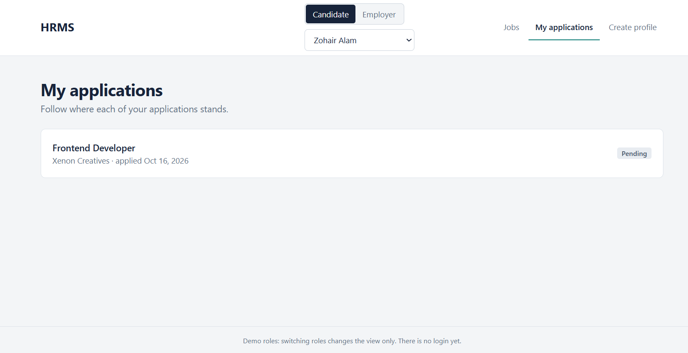

# HRMS: Human Resource Management System

A full-stack job board and hiring tracker. Employers post job advertisements and move applicants through hiring stages, and candidates browse jobs, apply, and follow their applications.

The backend is a **Spring Boot REST API** with PostgreSQL. The frontend is a **React** single-page app built with Vite and Tailwind CSS.


---

## Table of contents

- [Screenshots](#screenshots)
- [Features](#features)
- [Tech stack](#tech-stack)
- [Repository structure](#repository-structure)
- [Getting started](#getting-started)
- [Configuration](#configuration)
- [API reference](#api-reference)
- [Frontend overview](#frontend-overview)
- [Testing](#testing)
- [Deployment](#deployment)
- [Known limitations](#known-limitations)
- [Roadmap](#roadmap)

---

## Screenshots

### Browsing jobs and applying (candidate)

Candidates see every advertisement with its company, city, salary range, open positions and deadline. Applying is one click, using the profile chosen in the "Acting as" menu at the top of the page.


### Tracking applications (candidate)

The **My applications** page lists everything a candidate has applied to, with a status badge showing where each application stands.



### Registering a company (employer)

Employers register their company with a name, website, email, phone number and password. Server-side validation errors appear under the matching form field.


### Managing applicants (employer)

Employers choose one of their advertisements and see its applicants on a board with one column per hiring stage. A dropdown on each card moves the applicant to another stage.


---

## Features

**For candidates**
- Create a candidate profile
- Browse all job advertisements and filter them by city
- Apply to open advertisements with one click
- Follow the status of every application

**For employers**
- Register a company
- Post job advertisements (company is filled in automatically)
- Manage the shared lists of job positions and cities
- Review applicants for each advertisement on a stage-by-stage board and update their status

**Platform**
- Consistent `{ message, success, data }` response format on every endpoint
- Request validation with field-level error messages
- Global exception handling through `@ControllerAdvice`
- Duplicate protection (for example unique city names, emails and national IDs)
- CORS configured for a separately hosted frontend
- Demo role switcher between candidate and employer views (see [Known limitations](#known-limitations))

---

## Tech stack

| Layer | Technology |
|---|---|
| Backend language | Java 17 |
| Backend framework | Spring Boot 3, Spring Web, Spring Data JPA / Hibernate |
| Database | PostgreSQL |
| Validation | Jakarta Validation (`@NotBlank`, `@Size`, `@Email`, `@Future`, `@Past`) |
| Utilities | Lombok, Jackson |
| Backend testing | JUnit 5, MockMvc |
| Frontend | React, Vite, Tailwind CSS, React Router |
| Hosting | Railway (backend) |

---

## Repository structure

This is a monorepo containing the backend and the frontend.

```
.
├── hrms-app/        Spring Boot backend
├── frontend/        React frontend (Vite)
├── assets/          Screenshots used in this README
└── readme.md
```

### Backend (`hrms-app`)

```
hrms/hrms/
├── controller/    REST endpoints
├── business/      Service interfaces and implementations (business logic)
├── repository/    Spring Data JPA repositories
├── entity/        Database table mappings
├── dto/           Response objects
├── dto/request/   Incoming request models with validation rules
├── config/        Configuration (CORS)
└── core/          Shared result types: Result, DataResult, SuccessResult, ErrorResult
```

### Frontend (`frontend`)

```
src/
├── api.js             Fetch wrapper that understands the Result format
├── role.jsx           Demo role and "acting as" state
├── ui.jsx             Shared components (Button, Drawer, EntityForm, Badge...)
├── ResourcePage.jsx   Generic table with an "add" drawer
├── pages.jsx          Cities, employers, job positions and candidates
├── JobAds.jsx         Advertisements and applying
├── Applications.jsx   Employer board and candidate application list
└── App.jsx            Layout, routes and role switcher
```

---

## Getting started

### Prerequisites

- Java 17
- Maven (or use the Maven wrapper if the project includes one)
- PostgreSQL
- Node.js 18 or newer

### 1. Run the backend

1. Create a PostgreSQL database, for example `hrms`.
2. Set your database details in `hrms-app/src/main/resources/application.properties` (see [Configuration](#configuration)).
3. Start the API:

```bash
cd hrms-app
mvn spring-boot:run
```

The API is available at `http://localhost:8080`.

### 2. Run the frontend

```bash
cd frontend
npm install
cp .env.example .env     # then edit the value if your backend is not on localhost:8080
npm run dev
```

The app is available at `http://localhost:5173`.

### 3. Try it out

1. Switch to **Employer** in the top bar and open **Register company**. Register a company, then choose it in the "Acting as" menu.
2. Add a city under **Cities** and a position under **Positions**.
3. Open **My advertisements** and post a job.
4. Switch to **Candidate**, create a profile under **Create profile**, and choose it in "Acting as".
5. Open **Jobs** and apply.
6. Switch back to **Employer**, open **Applications**, choose the advertisement, and move the applicant between stages.

---

## Configuration

### Backend: `application.properties`

```properties
spring.datasource.url=jdbc:postgresql://localhost:5432/hrms
spring.datasource.username=your_user
spring.datasource.password=your_password
spring.jpa.hibernate.ddl-auto=update

# Origins allowed to call the API (comma-separated)
app.cors.allowed-origins=http://localhost:5173
```

When deploying, supply these through environment variables instead of committing credentials. Spring maps `app.cors.allowed-origins` to the variable `APP_CORS_ALLOWED_ORIGINS`.

### Frontend: `.env`

```
VITE_API_URL=http://localhost:8080
```

Vite reads this file only when it starts, so restart `npm run dev` after changing it. For a deployed build, set `VITE_API_URL` in your hosting provider's settings to your backend's public URL.

---

## API reference

All responses use the same shape:

```json
{
  "message": "Operation successful.",
  "success": true,
  "data": {}
}
```

Validation failures return `success: false` with a message, and field-level details where available.

### Endpoints

| Resource | Method | Endpoint | Description |
|---|---|---|---|
| Cities | POST | `/api/cities/add` | Add a city |
| | GET | `/api/cities/getAll` | List cities |
| Job positions | POST | `/api/jobPosition/add` | Add a job position |
| | GET | `/api/jobPosition/getAll` | List job positions |
| Employers | POST | `/api/employers/register` | Register an employer |
| | GET | `/api/employers/getAll` | List employers |
| Candidates | POST | `/api/candidateController/register` | Register a candidate |
| | GET | `/api/candidateController/getAll` | List candidates |
| Job advertisements | POST | `/api/jobPost/add` | Add an advertisement |
| | GET | `/api/jobPost/getAll` | List all advertisements |
| | GET | `/api/jobPost/active` | List active advertisements |
| | GET | `/api/jobPost/active/by-employer?employerId=` | Active advertisements for an employer |
| | GET | `/api/jobPost/sorted-by-deadline` | Advertisements sorted by deadline |
| | GET | `/api/jobPost/by-deadline?date=YYYY-MM-DD` | Advertisements with a given deadline |
| Applications | POST | `/api/applications/apply` | Apply to an advertisement |
| | POST | `/api/applications/update-status` | Change an application's status |
| | GET | `/api/applications/by-advertisement/{adId}` | Applications for an advertisement |
| | GET | `/api/applications/by-jobseeker/{seekerId}` | Applications by a candidate |
| System employees | POST | `/api/hrController/add` | Add a system employee |
| | GET | `/api/hrController/getAll/systemEmployee` | List system employees |

### Sample requests

**Add a city**

```json
POST /api/cities/add
{ "cityName": "Istanbul" }
```

**Add a job position**

```json
POST /api/jobPosition/add
{ "title": "Java Backend Developer" }
```

**Register an employer**

```json
POST /api/employers/register
{
  "companyName": "Tech Solutions Ltd.",
  "companyWebPage": "https://techsolutions.com",
  "email": "contact@techsolutions.com",
  "phoneNumber": "+90-555-123-4567",
  "password": "password123",
  "confirmPassword": "password123"
}
```

**Register a candidate**

```json
POST /api/candidateController/register
{
  "name": "Aysu",
  "lastName": "Ay",
  "nationalId": "12345678901",
  "birthDate": "1995-04-12",
  "email": "aysu@example.com",
  "password": "password123",
  "confirmPassword": "password123"
}
```

**Add a job advertisement**

```json
POST /api/jobPost/add
{
  "jobPositionId": 1,
  "cityId": 1,
  "employerId": 1,
  "description": "We are looking for a Java Backend Developer with Spring Boot experience.",
  "openPositionCount": 2,
  "minSalary": 30000,
  "maxSalary": 50000,
  "applicationDeadline": "2027-12-31"
}
```

The deadline must be a future date, and the description needs at least 10 characters.

**Apply for a job**

```json
POST /api/applications/apply
{ "jobAdvertisementId": 1, "jobSeekerId": 1 }
```

**Update an application's status**

```json
POST /api/applications/update-status
{ "applicationId": 1, "status": "ACCEPTED" }
```

`status` must be a value of the backend's `JobApplicationStatus` enum.

---

## Frontend overview

- **Role-aware navigation.** The top bar switches between candidate and employer views, and each role gets its own pages. Routes that don't belong to the current role redirect to the jobs page.
- **Slide-over forms.** Every "add" form opens in a drawer, so list pages stay uncluttered.
- **Pipeline board.** Applicants for an advertisement are grouped into columns by status. Any status the backend returns that the board doesn't know about still gets its own column, so no applications are hidden.
- **One API layer.** `api.js` reads the backend URL from `VITE_API_URL`, unwraps the `Result` format, and surfaces server messages and field errors in the UI.

---

## Testing

The backend has 27 unit and integration tests written with JUnit 5 and MockMvc.

| Test class | Type | What it tests |
|---|---|---|
| `CityDaoTest` | Unit | Saving, duplicate city name constraint |
| `CityControllerTest` | Integration | API responses, validation |
| `EmployerDaoTest` | Unit | Saving, duplicate email constraint |
| `JobSeekerDaoTest` | Unit | Saving, duplicate email and national ID |
| `JobPositionDaoTest` | Unit | Saving and retrieving |
| `JobAdvertisementDaoTest` | Unit | Saving with relations |
| `JobAdvertisementControllerTest` | Integration | Advertisement API responses |
| `JobApplicationDaoTest` | Unit | Application saving and status |

```bash
cd hrms-app
mvn test
```

---

## Deployment

- **Backend:** deployed on [Railway](https://railway.app) with a PostgreSQL database. Set the database variables and `APP_CORS_ALLOWED_ORIGINS` in the service's Variables tab.
- **Frontend:** any static host works (Vercel, Netlify, Cloudflare Pages). Set the build command to `npm run build`, the output directory to `dist`, and the environment variable `VITE_API_URL` to your backend's public URL. Because Vite reads variables at build time, rebuild after changing it.
- After the frontend is deployed, add its URL to `APP_CORS_ALLOWED_ORIGINS` on the backend, or browsers will block its requests.

---

## Known limitations

- **No authentication yet.** The candidate/employer switcher is a demo. It changes what the interface shows, but the API accepts any request. Real security needs login, password hashing and token-based permissions on the backend.
- **"My advertisements" matches by company name.** The advertisement response doesn't include an employer ID, so two companies with the same name would see each other's advertisements.
- **No pagination or search.** Lists load in full, which is fine for small data sets.

---

## Roadmap

- [ ] Authentication and authorization (Spring Security, JWT, `CANDIDATE` and `EMPLOYER` roles)
- [ ] Take the user's identity from the token instead of from request bodies
- [ ] Add `employerId` to the advertisement response
- [ ] Pagination, sorting and text search
- [ ] Edit and close advertisements
- [ ] Candidate CVs and profile pages
- [ ] Email notifications when an application's status changes
